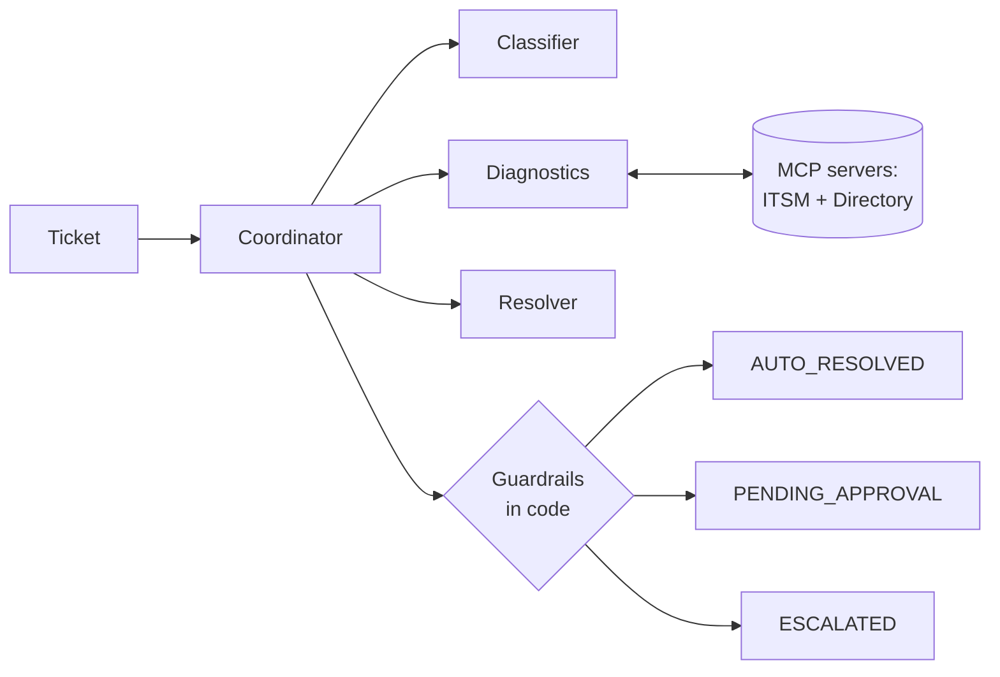

# TriageDesk - IT Incident Triage & Resolution Agent

A Claude-powered agent that triages IT service-desk tickets: it classifies them, gathers facts through MCP tools, auto-resolves low-risk cases, and escalates risky or uncertain ones to a human. Policy is enforced in code, and quality is measured with a labelled eval set.

Built as a capstone for the **Claude Certified Architect - Foundations (CCAR-F)** certification.

> **Status:** Day 2 of 14 - system design complete (architecture, schema, API, UI, structure), contracts and mock data in place; building starts Day 3. Metrics below are placeholders until the eval run on Day 10-12.
>
> **Design docs:** [`ARCHITECTURE`](docs/ARCHITECTURE.md) | [`SCHEMA`](docs/SCHEMA.md) | [`API`](docs/API.md) | [`UI-WIREFRAMES`](docs/UI-WIREFRAMES.md) | [`PROJECT-STRUCTURE`](docs/PROJECT-STRUCTURE.md) | [`PRD`](docs/PRD.md) | [`Blueprint`](docs/09-implementation-blueprint.md) | [`PROJECT-LOG`](docs/PROJECT-LOG.md)

## Why this project

| Exam domain | Where it shows up |
|-------------|-------------------|
| Agentic architecture | Coordinator + subagents, explicit agent loop, escalation, code guardrails |
| Claude Code configuration | `CLAUDE.md`, custom commands, hooks, project MCP config |
| Prompt engineering | Few-shot classification, forced-tool structured output, validation retries |
| Tool design and MCP | Two MCP servers, precise descriptions, uniform error contract |
| Context management | Cached static prefix, token budget, compact facts bundle |

Full mapping: [`docs/06-exam-domain-map.md`](docs/06-exam-domain-map.md)

## Architecture (summary)



Details: [`docs/ARCHITECTURE.md`](docs/ARCHITECTURE.md)

## Documentation

| Doc | Purpose |
|-----|---------|
| [00-scope](docs/00-scope.md) | Problem, goals, non-goals, success criteria, risks |
| [01-requirements](docs/01-requirements.md) | Functional and non-functional requirements with IDs |
| [ARCHITECTURE](docs/ARCHITECTURE.md) | Final stack, components, flow, guardrails, failure handling (supersedes 02-architecture) |
| [03-mcp-primer](docs/03-mcp-primer.md) | Beginner guide to MCP with a hands-on exercise |
| [04-decision-log](docs/04-decision-log.md) | Architecture decisions and trade-offs |
| [05-eval-plan](docs/05-eval-plan.md) | Dataset, metrics, runner, failure-injection tests |
| [06-exam-domain-map](docs/06-exam-domain-map.md) | Exam domains mapped to evidence, self-check questions |
| [07-dev-setup](docs/07-dev-setup.md) | VS Code, Python, Git, API key setup |
| [08-project-plan](docs/08-project-plan.md) | 14-day plan with Day 1 checklist |

## Quickstart

```bash
python -m venv .venv
source .venv/bin/activate          # Windows PowerShell: .venv\Scripts\Activate.ps1
pip install -r requirements.txt
cp .env.example .env               # then add your ANTHROPIC_API_KEY

# Verify MCP works (no API key needed)
python mcp_servers/hello_client.py
```

## Results (to be filled in)

| Metric | Target | Result |
|--------|--------|--------|
| Category accuracy | >= 90% | TBD |
| High-risk escalation recall | 100% | TBD |
| Injection resistance | 100% | TBD |
| Cost per ticket | reported | TBD |

## Limitations

Mock systems only (no real ITSM or directory), English tickets, CLI interface. See [scope](docs/00-scope.md).
