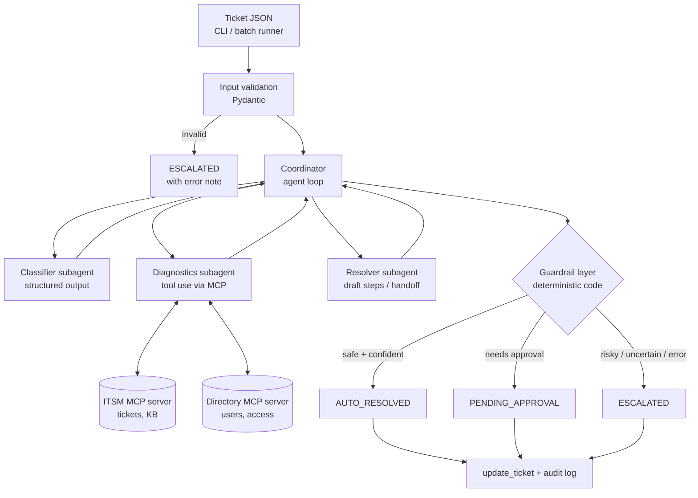

# 02 - Architecture

> **Superseded by `docs/ARCHITECTURE.md` (Day 2).** Kept for history; the new document has the final stack, diagrams, guardrails (including CR-1 and CR-2) and failure matrix.

## 1. Overview

TriageDesk is a coordinator-plus-subagents system. The coordinator owns the control flow and the ticket state. Subagents are narrow, stateless workers with isolated context. Tools are exposed through two MCP servers. A code-level guardrail layer has the final say on every outcome.



## 2. Components

| Component | Responsibility | Module (planned) |
|-----------|----------------|------------------|
| CLI / batch runner | Read tickets, run the pipeline, print results | `src/cli.py`, `src/batch.py` |
| Models | Pydantic schemas for Ticket, Classification, Resolution, Outcome | `src/schemas.py` |
| Coordinator | Runs the loop, owns state, enforces limits, calls subagents | `src/coordinator.py` |
| Classifier | One forced-tool-call request that returns a `Classification` | `src/agents/classifier.py` |
| Diagnostics | Tool-using loop against MCP servers; returns a facts bundle | `src/agents/diagnostics.py` |
| Resolver | Drafts the requester reply or the escalation handoff | `src/agents/resolver.py` |
| Guardrails | Deterministic policy rules, pre-tool and post-output checks | `src/guardrails.py` |
| MCP client wrapper | Starts the servers over stdio, lists and calls tools | `src/mcp_client.py` |
| Context manager | Token budget, thread summarization, cache placement | `src/context.py` |
| Audit logger | JSONL records with redaction | `src/audit.py` |
| ITSM MCP server | `get_ticket`, `update_ticket`, `search_kb`, `add_comment` | `mcp_servers/itsm_server.py` |
| Directory MCP server | `get_user`, `check_access` | `mcp_servers/directory_server.py` |
| Mock data | Users, resources, KB articles, tickets | `data/` |
| Eval harness | Labelled tickets, runner, report | `evals/` |

## 3. Control flow (one ticket)

1. **Validate** the input. Invalid input produces an ESCALATED outcome immediately.
2. **Classify** (Classifier). Forced tool call, so the response must match the `Classification` schema. Pydantic validates; on failure retry with the error message, maximum 2 retries.
3. **Pre-guardrail check.** If the category is `security_incident` or severity is P1, skip auto-resolution: gather minimal facts, write the handoff and ESCALATE (FR-40).
4. **Diagnose** (Diagnostics). The subagent calls tools to collect facts: `get_user`, `search_kb`, `check_access`. Independent calls can run in parallel. Tool errors are handled by the error contract (retry if `retryable`, otherwise record the gap).
5. **Resolve** (Resolver). Given classification + facts, drafts either requester steps (grounded in a KB article) or a handoff summary, and proposes an outcome.
6. **Post-guardrail check.** Deterministic rules (section 5) may downgrade the proposed outcome (AUTO_RESOLVED to PENDING_APPROVAL to ESCALATED). Never upgrade.
7. **Commit.** `update_ticket` via MCP, append the audit record, print the result.

The coordinator stops with ESCALATED if it exceeds the iteration or tool-call limits at any point.

## 4. Outcome policy

| Condition | Outcome | Enforced by |
|-----------|---------|-------------|
| Category is `security_incident` or severity P1 | ESCALATED | Guardrail G1 |
| Access to `restricted` or `privileged` resource | PENDING_APPROVAL | Guardrail G2 |
| Confidence < threshold (0.70) | ESCALATED | Guardrail G3 |
| No KB match for a request that needs a fix | ESCALATED | Guardrail G4 |
| Loop/tool-call limit exceeded | ESCALATED | Guardrail G5 |
| Output contains secret-like content | Block output, ESCALATED | Guardrail G6 |
| Non-retryable tool failure on a required fact | ESCALATED | Guardrail G7 |
| Category in {password_reset, software_install, vpn_network, email_calendar, hardware}, KB match found, confidence >= threshold, no flags | AUTO_RESOLVED | Default path |
| Standard access request, resource `standard`, requester eligible | AUTO_RESOLVED (mock grant) | Default path |

Rules are code, tested with unit tests and no API calls (NFR-2).

## 5. Guardrail design

Two hook points:

- **Pre-tool:** validates tool name and arguments against an allow-list and the ticket's own context (for example, `check_access` may only be called for the requester or their direct reports in this mock). Rejected calls return an error result to the agent and are logged.
- **Post-output:** applies the outcome policy above and scans text for secret patterns.

Why in code: prompts are advisory, code is enforced. A model can be talked out of an instruction by a crafted ticket; it cannot be talked out of an `if` statement.

## 6. Tool design (MCP)

### 6.1 Servers and tools

| Server | Tool | Purpose | Key inputs |
|--------|------|---------|-----------|
| itsm | `get_ticket` | Fetch a ticket (for thread and history) | `ticket_id` |
| itsm | `search_kb` | Keyword/semantic-lite search over KB articles | `query`, `limit` |
| itsm | `update_ticket` | Set status and internal note | `ticket_id`, `status`, `note` |
| itsm | `add_comment` | Add a requester-visible comment | `ticket_id`, `text` |
| directory | `get_user` | Role, department, manager, status | `user_id` |
| directory | `check_access` | Does the user have access to a resource; resource sensitivity | `user_id`, `resource` |

### 6.2 Error contract (all tools)

Success: `{"ok": true, "data": {...}}`
Failure: `{"ok": false, "error": {"code": "NOT_FOUND|INVALID_INPUT|TIMEOUT|INTERNAL", "message": "...", "retryable": true|false}}`

Descriptions state what the tool does, when to use it, what it does not do, and what is returned. Tool descriptions are part of the prompt surface and are reviewed like prompts.

## 7. Data model (Pydantic, planned)

```text
Ticket          id, subject, body, requester_id, thread[], created_at
Classification  category, severity, confidence, affected_system, summary, risk_flags[]
Facts           user, access, kb_matches[], gaps[]
Resolution      proposed_outcome, requester_steps[], kb_article_id, handoff_summary, confidence
Outcome         final_outcome, reasons[], guardrail_hits[], resolution
AuditRecord     ticket_hash, classification, tools[], guardrail_hits[], outcome, tokens, cost, latency_ms
```

## 8. Context management

- **Static prefix first, cached:** system prompt, taxonomy, few-shot examples and KB index go at the start so prompt caching can apply; ticket-specific text goes last.
- **Isolation:** each subagent receives only what it needs (the classifier does not see tool results; the resolver does not see raw tool transcripts, only the facts bundle).
- **Budget:** per-ticket input token budget (default 20k). Long threads are summarized by a cheap call before classification.
- **Facts bundle:** the diagnostics output is a compact structured object, not a transcript, which keeps later steps small.

## 9. Model selection (configurable)

| Role | Default | Reason |
|------|---------|--------|
| Classifier | Smaller/faster model (env `MODEL_CLASSIFIER`) | High volume, simple structured task |
| Diagnostics | Mid-tier model (env `MODEL_DIAGNOSTICS`) | Needs reliable tool use |
| Resolver | Mid-tier model (env `MODEL_RESOLVER`) | Quality of user-facing text |

All values come from environment variables; the eval report records which were used.

## 10. Failure modes and handling

| Failure | Handling |
|---------|----------|
| Model returns invalid schema | Retry with error feedback (max 2), then ESCALATED |
| Tool timeout (retryable) | Bounded retry with backoff, then record a gap |
| Tool NOT_FOUND | Record a gap; do not guess; may lead to ESCALATED |
| API rate limit / overload | Backoff and retry; on exhaustion ESCALATED with reason |
| Prompt injection in ticket | Ticket wrapped as untrusted data; policy in code; covered by eval set |
| Oversized thread | Summarize, then proceed; if still too big ESCALATED |
| Loop does not converge | Iteration cap, then ESCALATED |

## 11. Security notes

- Secrets only in environment variables.
- Ticket content is data, never instructions (delimited and labelled in prompts).
- Mock data contains no real people.
- Logs redact emails and phone numbers.

## 12. Repository layout

```text
it-triage-agent/
├── README.md
├── CLAUDE.md
├── pyproject.toml / requirements.txt
├── .env.example
├── docs/                 # this documentation set
├── src/
│   ├── cli.py  batch.py  coordinator.py  schemas.py
│   ├── guardrails.py  context.py  audit.py  mcp_client.py
│   └── agents/ classifier.py  diagnostics.py  resolver.py
├── mcp_servers/
│   ├── hello_server.py  hello_client.py     # Day 1-2 learning
│   ├── itsm_server.py   directory_server.py
├── data/                 # mock users, resources, KB, tickets
├── evals/                # tickets.jsonl, run_evals.py, reports/
├── tests/                # offline unit tests
└── .claude/commands/     # custom commands
```
