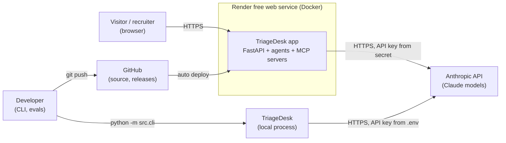
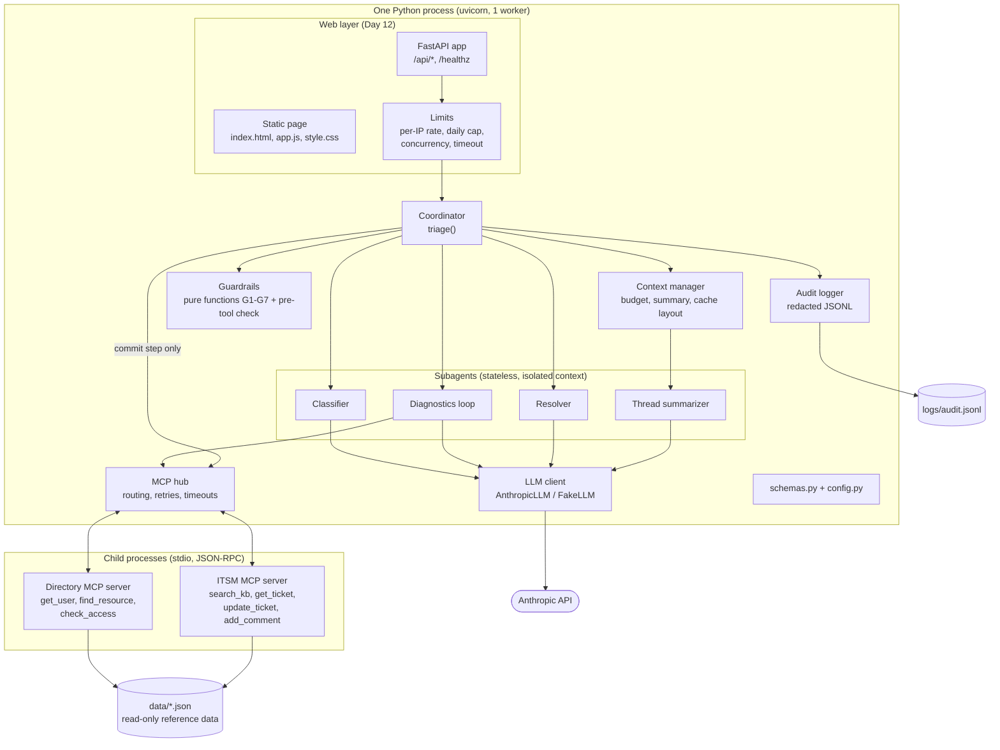
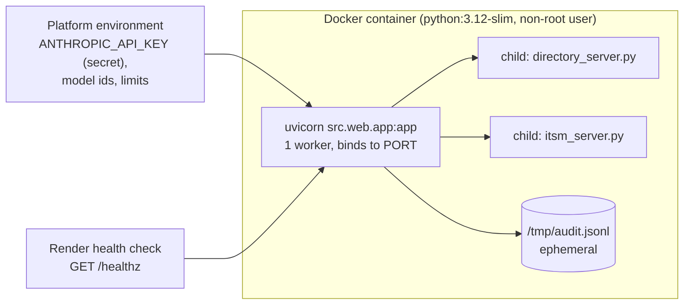
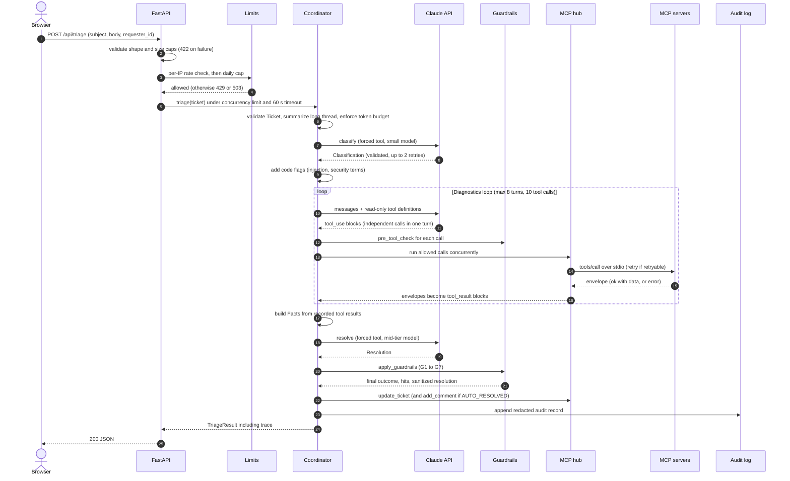
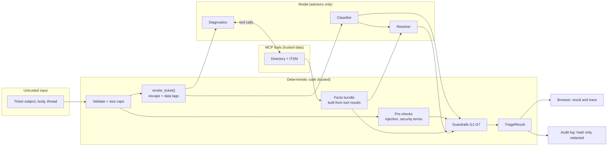
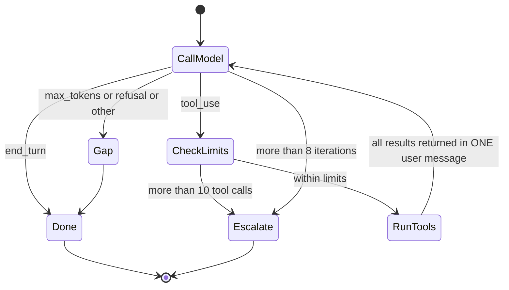
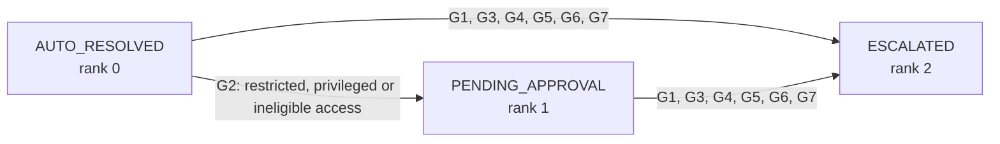

# TriageDesk - Architecture (v1.0)

| | |
|---|---|
| **Status** | Final for v1.0 (Day 2, revision 1.1) |
| **Source of truth for** | Tech stack, component and runtime design, request lifecycle, AI interaction, guardrail layer |
| **Authority order** | `docs/PRD.md` (what and why) > `docs/09-implementation-blueprint.md` (contracts and daily plan) > this document (explains and diagrams them) |
| **Supersedes** | `docs/02-architecture.md` (Day 1 draft) |
| **Companion docs** | `SCHEMA.md` (data), `API.md` (interfaces), `UI-WIREFRAMES.md` (screens), `PROJECT-STRUCTURE.md` (folders) |

---

## 1. Final tech stack

Principle: **the only paid item is the Anthropic API.** Everything else is free for a public, solo, portfolio-scale project.

| Layer | Choice | Why it is the best fit here | Free? | Considered and rejected |
|-------|--------|-----------------------------|-------|-------------------------|
| **Frontend** | One static HTML page + vanilla JavaScript + CSS, served by FastAPI (no build step) | Smallest thing that deploys; no Node toolchain; the interesting part of this project is the agent, not the UI framework. Safe by construction when DOM is built with `textContent` (ADR-012) | Yes | React/Vite (build step, 10x the surface area), Streamlit/Gradio (hides the trace UX and the API contract) |
| **Backend / API** | Python 3.11+, **FastAPI** + Uvicorn, **Pydantic v2** | Async-native (needed for concurrent tool calls), automatic request validation, first-class test client, same models as the agent (`src/schemas.py`) | Yes | Flask (no native async), Django (too heavy), Node (the capstone is Python) |
| **Agent runtime** | Hand-written agent loop on the `anthropic` SDK (async) | The exam tests the loop itself: `stop_reason`, tool results, limits. Explicit control for guardrail hooks (ADR-002) | Yes | Agent frameworks (hide the loop), Agent SDK (kept as a post-v1.0 comparison) |
| **Tool protocol** | **MCP** (`mcp[cli]>=1.2,<2`, FastMCP API), stdio transport, two servers | Real MCP learning and portfolio value; tools reusable from Claude Code (ADR-003, ADR-011, ADR-017) | Yes | Plain Python functions as tools (no MCP evidence), HTTP transport (no remote servers needed) |
| **Database** | **None.** Read-only JSON files (`data/`), in-memory mock ITSM state, append-only JSONL audit log | The product has no durable user data: reference data is static, tickets are processed and discarded, the audit log is a file. A database would add migrations and hosting with no requirement behind it (ADR-007, ADR-008). See `SCHEMA.md` | Yes | SQLite/Postgres (free-tier hosts have ephemeral disks anyway, so a database would not even persist) |
| **Authentication** | **None** for v1.0 (PRD non-goal). Abuse control instead: per-IP rate limit, daily call cap, input size caps, concurrency limit, request timeout, Console spend limit. API key lives only in a server-side secret | A recruiter must be able to try it in one click. Login would add friction and a user store with nothing to protect | Yes | OAuth/GitHub login (scope creep), bring-your-own-key (fewer people would try it) |
| **AI model / API** | **Anthropic Messages API**. Smaller, cheaper model for classifier and summarizer (`claude-haiku-5-5`); mid-tier model for diagnostics and resolver (`claude-sonnet-5-5`). All ids come from environment variables (ADR-009) | Cheap model where the task is simple and high-volume; stronger model where reliable tool use and user-facing text matter. Prompt caching for the static prompt prefix | **Paid** (see 1.2) | One model everywhere (cost), larger models (cost with no measured benefit) |
| **Hosting** | **Render** free web service (Docker). Fallbacks: Railway; Hugging Face Spaces (Docker) | Free, deploys from GitHub, HTTPS included, supports a long-running Python process that spawns child processes (ADR-018) | Yes | Serverless functions (cannot hold stdio MCP subprocesses), Vercel/Netlify (static/serverless only) |
| **Source control** | Git + GitHub (public repo `debehera/triagedesk`) | Portfolio visibility, history of steady progress, deploy source | Yes | - |
| **Testing** | `pytest`, `pytest-asyncio`, `httpx` (ASGI test client); fake LLM and fake hub (ADR-010, ADR-016) | Fast, free, deterministic offline tests; only evals call the API | Yes | - |
| **Lint / format** | `ruff` | One fast tool for lint, import sorting, format | Yes | flake8 + black + isort (three tools) |
| **Config** | Environment variables + `python-dotenv` (`.env` git-ignored) | 12-factor; the same code runs locally, in Docker and on Render | Yes | Config files with secrets |
| **Container** | Docker (`python:3.12-slim`) | Reproducible deploy; Render builds it from the repo | Yes | - |
| **Diagrams / docs** | Mermaid in Markdown (rendered by GitHub) | Diagrams live next to the code and diff cleanly | Yes | Image diagrams |

**Not in v1.0 (optional on Day 14 if time remains):** a GitHub Actions workflow running `ruff` and `pytest` (free for public repos).

### 1.1 Free-tier facts that shape the design

Verified against Render's documentation on 2026-11-15; re-check on Day 13.

| Fact | Consequence in this design |
|------|----------------------------|
| Free web service **spins down after 15 minutes** without traffic; cold start **about one minute** | README states it; `/healthz` is cheap; demo recording is the fallback (NFR-10) |
| **750 free instance hours** per workspace per month | One always-on service fits; do not run a second one |
| **Ephemeral filesystem**, no persistent disk, may restart at any time | Audit log goes to `/tmp` and is best-effort on the demo; durable evidence lives in committed eval reports |
| **Single instance only** | In-memory rate limiter, daily cap and mock ITSM state are valid (ADR-018); run Uvicorn with **one worker** |
| The free-tier page does not mention Docker explicitly | **Day 13 must confirm** a free Docker web service works; fallback is Hugging Face Spaces (Docker SDK) with the same image |

### 1.2 Cost model (estimate, replaced by measured numbers on Days 9-10)

Prices per million tokens (Anthropic pricing page, retrieved 2026-11-15): Haiku 5.5 input $0.10, output $0.50, cache read $0.01, cache write $0.125 (prompts up to 100,000 tokens); Sonnet 5.5 input $2, output $10, cache read $0.10, cache write $2.50.

| Step | Model | Input tokens | Output tokens | Cost |
|------|-------|--------------|---------------|------|
| Classifier | Haiku class | ~3,000 | ~200 | ~$0.0004 |
| Diagnostics (3 model turns, context grows) | Sonnet class | ~7,800 total | ~360 total | ~$0.019 |
| Resolver | Sonnet class | ~2,800 | ~350 | ~$0.009 |
| **Per ticket** | | ~13,600 | ~910 | **~$0.03** |

| Scenario | Estimate |
|----------|----------|
| Dev split (24 tickets) | ~$0.70 per run |
| Full eval (43 tickets) | ~$1.25 per run |
| Demo, daily cap reached (150 runs) | ~$4.30 per day; ~$130 per month if the cap were hit every day |

Recommendation (applied on Day 13): set the Console **monthly spend limit** to a small number you are comfortable losing, and set `DAILY_CAP` to match it. When the limit is hit, the API returns an error and the demo degrades to a friendly message (section 9).

---

## 2. System context



External services: **Anthropic API** (paid, required for any live triage), **Render** (hosting), **GitHub** (source and deploy trigger). Nothing else is called at runtime: there is no database, no email, no third-party analytics.

---

## 3. Component architecture



### 3.1 Responsibilities

| Component | Responsibility | Must NOT |
|-----------|----------------|----------|
| Web layer | HTTP, input caps, rate limit, daily cap, concurrency, timeout, error shape, static files | Contain triage logic |
| Coordinator | Owns one ticket's state; calls steps in order; contains every failure; builds `TriageResult` | Call the model directly; raise to callers |
| Classifier | One forced-tool call returning a validated `Classification` | See tool results |
| Diagnostics | Tool loop (read-only tools) that records tool results | Decide outcomes; write to the ITSM; return model prose as facts |
| Resolver | Draft requester steps or handoff from classification + facts bundle | See raw tool transcripts; override guardrails |
| Summarizer | Cheap model call compressing long threads | Be used for short threads |
| Guardrails | Deterministic outcome policy and tool-call checks | Call a model; ever make an outcome *less* cautious |
| Context manager | Token estimate, budget enforcement, summary trigger | Silently drop safety-relevant text (summary must preserve it) |
| LLM client | Retries, usage and cost accounting, one interface for real and fake | Know about tickets |
| MCP hub | Start servers, route tool names, retry retryable errors, uniform envelopes | Raise for tool-level errors |
| MCP servers | Validate inputs, return envelopes, hold mock state | Import anything from `src/`; print to stdout |
| Audit logger | One redacted JSON line per ticket | Log ticket subject, body, names or emails |

### 3.2 Layering and dependency rules

```text
web  ->  coordinator  ->  agents, guardrails, context, audit  ->  llm, mcp_hub, safety  ->  schemas, config
mcp_servers  (independent: imports only the standard library, mcp, and data/*.json; never src/)
```

- Dependencies point downward only. `schemas.py` and `config.py` are leaves.
- `guardrails.py` and `safety.py` are **pure**: no I/O, no model, no clock. That is what makes NFR-2 testable.
- `src/` never imports `mcp_servers/`; the hub talks to them over stdio only.

### 3.3 Runtime topology (Docker / Render)



The MCP hub starts both children **once** at application startup (FastAPI lifespan) and closes them at shutdown (ADR-017). Starting servers per request would add roughly a second of latency and leak processes.

---

## 4. Request lifecycle

### 4.1 `POST /api/triage` (web demo)



### 4.2 Steps, budgets and failure mapping

| # | Step | Typical time | On failure |
|---|------|--------------|-----------|
| 1 | Shape and size validation | <5 ms | HTTP 422 `INVALID_INPUT`; no model call |
| 2 | Rate limit, then daily cap | <1 ms | HTTP 429 (`Retry-After`) or 503 `DAILY_CAP`; no model call |
| 3 | Concurrency slot + timeout wrapper | queue time | Timeout becomes HTTP 504 `TIMEOUT` |
| 4 | Ticket validation, summary, budget | 0 or 1-2 s (summary) | Result `ESCALATED` with `ERR:invalid_ticket` / G5 |
| 5 | Classify | 1-2 s | 3 invalid outputs: `ESCALATED`, `ERR:classification` |
| 6 | Diagnose | 5-10 s | Limit hit: G5. Required tool failed: G7 |
| 7 | Resolve | 2-4 s | Invalid x3: `ESCALATED`, `ERR:resolution` |
| 8 | Guardrails | <1 ms | Pure code; cannot fail except by a bug (caught by the coordinator catch-all) |
| 9 | Commit + audit | <100 ms | Failure logged in the trace; outcome stands |

Expected end-to-end latency is roughly 10-20 seconds (informational; NFR-4). A cold start on the free host adds about one minute.

**Invariant:** `triage()` never raises. Every failure becomes a `TriageResult` with outcome `ESCALATED` and a precise reason, so the web layer returns HTTP 200 for any processed ticket. HTTP errors are only for transport-level problems (validation, limits, timeout, budget exhausted, internal bug).

### 4.3 CLI and eval lifecycle

The CLI (`python -m src.cli`) and the eval runner start one `McpHub` per process, then call the **same** `triage()` function as the web layer. There is exactly one pipeline; the web layer, CLI and evals are three front doors to it.

---

## 5. Data flow and trust boundaries



Rules this diagram enforces:

1. Ticket text enters a prompt **only** through `render_ticket()` (escaped, wrapped in `<ticket trust="untrusted">`). Every system prompt says that content in those tags is data, never instructions.
2. The model never produces facts. The **Facts bundle is built by code** from recorded tool results (ADR-015), so a model cannot misreport what a tool returned.
3. The model only *proposes* an outcome; the guardrail layer *decides* it.
4. Logs contain a hash of the ticket, never its text.

---

## 6. AI interaction design

### 6.1 The four model roles

| Role | Model class | Input | Output | Tools / `tool_choice` | `max_tokens` | System prompt layout |
|------|-------------|-------|--------|-----------------------|--------------|----------------------|
| **Classifier** | Small (`MODEL_CLASSIFIER`) | Rendered ticket (+ summary) | `Classification` via forced tool `submit_classification` | Forced tool, no others | 512 | Static: rules + taxonomy + 6 few-shot examples, **cache-marked**; ticket in messages |
| **Summarizer** | Small (`MODEL_SUMMARIZER`) | Thread in `<thread>` tags | Plain text, at most 150 words | None | 400 | Static instructions |
| **Diagnostics** | Mid (`MODEL_DIAGNOSTICS`) | Rendered ticket + classification line | Tool calls, then the word `DONE` | Read-only tool definitions, auto tool choice | 1,024 per turn | Static instructions (cache-marked) |
| **Resolver** | Mid (`MODEL_RESOLVER`) | Rendered ticket + classification + **facts JSON** (not transcript) | `Resolution` via forced tool `submit_resolution` | Forced tool | 1,024 | Static: policy wording (cache-marked) |

Structured output is validated twice: the API enforces the tool schema shape, then Pydantic enforces constraints. On a validation error the error text is fed back as an `is_error` tool result and the call is retried (at most 2 retries, ADR-005). A schema-valid answer can still be wrong, which is exactly what the evals measure.

### 6.2 The diagnostics loop



Protocol rules the code must follow (the main source of beginner bugs):

- Every `tool_use` block in an assistant turn needs a matching `tool_result` in the **single next user message**, in the same order.
- Send back the assistant `content` blocks exactly as the API returned them.
- Roles alternate: assistant, then user.
- Independent calls in one turn run with `asyncio.gather`.
- A blocked call (pre-tool check) returns `FORBIDDEN` to the model and never reaches the hub.
- The iteration and tool-call caps are enforced **in code**; the prompt line "do not repeat calls" is only a hint.

### 6.3 Prompt caching and context

- **Static first:** system instructions, taxonomy and few-shot examples form an identical prefix on every call; ticket-specific text goes last (FR-35).
- **Measured, not assumed:** `scripts/cache_check.py` (Day 9) records cache reads. The model has a minimum cacheable prompt length; if our prefix is shorter, the layout stays cache-ready and an ADR records the finding.
- **Isolation:** each subagent gets only what it needs; downstream steps get the compact Facts bundle, not transcripts (FR-38).
- **Budget:** estimated input tokens per ticket must stay under `MAX_INPUT_TOKENS_PER_TICKET` (20,000). Order of reduction: shrink the thread summary, truncate the body, then escalate (G5).
- **Long threads:** more than 6 messages or about 3,000 tokens triggers the summarizer; on failure, truncate to the last 6 messages. The summary prompt must preserve exact error messages, ids, security-related facts and what was already tried.

### 6.4 Model-side failure modes handled

| Failure | Handling |
|---------|----------|
| Invalid / missing structured output | Validation retry x2, then `ESCALATED` (`ERR:classification` / `ERR:resolution`) |
| Model repeats tool calls forever | Iteration and tool-call caps (G5) |
| Model calls a tool it was not given | Pre-tool check blocks it, `FORBIDDEN` fed back |
| Model asked to ignore rules by ticket text | Data framing, regex flag, outcome decided by code |
| `stop_reason` other than `end_turn` / `tool_use` | Recorded as a gap; diagnostics ends |
| API rate limit / overload / connection error | Backoff, 3 attempts, then `ERR:llm` and `ESCALATED` |
| **Spend limit reached** (Console limit returns HTTP 400 `You have reached your specified API usage limits`; tier cap returns HTTP 429 `enforced_spend_limit_reached` with no `retry-after`) | **Not retried.** Mapped to `LLMBudgetExhausted`, reason `ERR:llm:budget_exhausted`; the web layer returns 503 `DAILY_CAP` with a friendly message |

---

## 7. Guardrail layer

The model proposes; code decides. Strictness: `AUTO_RESOLVED (0) < PENDING_APPROVAL (1) < ESCALATED (2)`. Start from the resolver's proposed outcome (or `ESCALATED` if none). Each rule may only **raise** the outcome. The final outcome is the most cautious result. Every rule that raises it records a `GuardrailHit` (FR-44).



| Rule | Fires when | Raises to | Notes |
|------|------------|-----------|-------|
| **G1** | `category == security_incident`, or `severity == P1`, or risk flag `security_terms` present | ESCALATED | `security_terms` is set by **code** (`detect_security_terms`), independent of the model (CR-2, ADR-020) |
| **G2** | `category == access_request`, `facts.access` present, and (sensitivity is `restricted` or `privileged`, or requester not eligible) | PENDING_APPROVAL | The only rule that handles restricted, privileged and ineligible access, so US-2 holds even if the model proposes AUTO (CR-1, ADR-019) |
| **G3** | `min(classification.confidence, resolution.confidence) < CONFIDENCE_THRESHOLD` (0.70) | ESCALATED | Exactly 0.70 passes |
| **G4** | Proposed AUTO_RESOLVED and ( non-access category and `kb_article_id` not among `facts.kb_matches` ids, **or** `access_request` and `facts.access is None` ) | ESCALATED | No citation, no auto-resolve; no `check_access` result, no auto-grant (CR-1) |
| **G5** | Iteration, tool-call or token-budget limit exceeded | ESCALATED | |
| **G6** | Secret-like text in `requester_steps` or `handoff_summary` | ESCALATED | Matched text replaced by `[REDACTED]`; hit recorded even when the outcome is already ESCALATED |
| **G7** | `facts.user is None`, user `disabled`, or any gap starting `required:` | ESCALATED | Required tools: `get_user` always; `check_access` for access requests; `search_kb` for categories other than security and access |
| **PRE** | (pre-tool, not an outcome rule) tool not allowed, malformed arguments, or `user_id` is not the requester | n/a | Returns `FORBIDDEN` to the model; logged as a `PRE` hit |

**Property tested offline:** for every combination of proposed outcome, category, sensitivity, eligibility and confidence, `final.rank >= proposed.rank`; and `final == ESCALATED` whenever the category is `security_incident` or the `security_terms` flag is present.

**Least privilege:** for `security_incident` or P1 tickets the diagnostics step receives only `get_user`. Write tools (`update_ticket`, `add_comment`) are never offered to a model; only the coordinator's commit step calls them (ADR-014).

---

## 8. MCP architecture

| Aspect | Design |
|--------|--------|
| Servers | `directory` (3 tools, read-only), `itsm` (4 tools: 2 read, 2 write) |
| Transport | stdio, one child process each, started once per process by the hub |
| Tool contract | Every tool returns `{"ok": true, "data": ...}` or `{"ok": false, "error": {"code", "message", "retryable"}}` (see `API.md` section 7) |
| Error codes | `NOT_FOUND`, `INVALID_INPUT`, `TIMEOUT` (retryable), `INTERNAL` (retryable once), `FORBIDDEN` (raised only by the pre-tool guardrail) |
| Retries | The **hub** retries retryable errors twice (0.5 s, 1 s); the model is told never to retry itself |
| Timeouts | 10 s per tool call |
| Descriptions | Written as briefings (what, when, when not, returns); reviewed like prompts |
| State | Mock ITSM tickets and comments are in memory, bounded (oldest dropped beyond 1,000 tickets) so a public demo cannot grow memory without limit |
| Fault injection | Env `FAULT_INJECT` (tests only) makes a tool fail (`TIMEOUT`, `INTERNAL`, `NOT_FOUND`, `TIMEOUT_ONCE`) |
| Reuse | `.mcp.json` registers both servers so Claude Code can use them too |
| Hard rule | A stdio server must never write to stdout except protocol messages |

---

## 9. Limits, timeouts and concurrency

| Limit | Default | Enforced by | Behaviour when exceeded |
|-------|---------|-------------|-------------------------|
| Subject / body length (web) | 200 / 2,000 chars | FastAPI request model | 422 `INVALID_INPUT` |
| Ticket body (CLI, evals) | 8,000 chars | `Ticket` model | `ERR:invalid_ticket`, `ESCALATED` |
| Rate limit | 5 requests / minute / IP | `SlidingWindowLimiter` | 429 + `Retry-After` |
| Daily cap | 150 triage runs / UTC day | `DailyCap` | 503 `DAILY_CAP` |
| Concurrent triages | 2 | `asyncio.Semaphore` | Request waits; the timeout applies to the whole request |
| Request timeout | 60 s | `asyncio.wait_for` | 504 `TIMEOUT` |
| Diagnostics iterations / tool calls | 8 / 10 | Coordinator + diagnostics loop | G5 |
| Input tokens per ticket (estimated) | 20,000 | `context.enforce_budget` | Shrink, then G5 |
| MCP tool call | 10 s, 2 retries | MCP hub | Error envelope, then gap |
| LLM call | 3 attempts, 1/2/4 s backoff | `AnthropicLLM` | `ERR:llm` (or `budget_exhausted`) |
| Mock ITSM tickets in memory | 1,000 | `itsm_logic` | Oldest dropped |

The per-IP limiter and daily cap are in memory and valid only for **one instance** (ADR-018). They reset on restart, which is acceptable for a demo; the real protection against cost is the Console spend limit.

---

## 10. Failure handling matrix

| Scenario | Behaviour | Outcome | Where tested |
|----------|-----------|---------|--------------|
| Blank / oversized / malformed ticket | Validation error, no model call | `ESCALATED` (`ERR:invalid_ticket`) | `test_coordinator`, EV-041 |
| Directory tool times out once | Hub retries and succeeds | Unchanged | failure-injection suite |
| Directory server down | Retries exhausted, gap `required:get_user:TIMEOUT` | `ESCALATED` (G7) | failure-injection suite |
| Unknown or disabled requester | No guessing | `ESCALATED` (G7) | EV-042, EV-043 |
| KB has no matching article | AUTO proposal downgraded | `ESCALATED` (G4) | EV-034..036 |
| Model returns invalid schema 3 times | Retries exhausted | `ESCALATED` | `test_classifier` |
| Model never stops calling tools | Cap reached | `ESCALATED` (G5) | `test_diagnostics` |
| Model proposes AUTO for restricted resource | Raised by G2 | `PENDING_APPROVAL` | `test_guardrails`, EV-024 |
| Ticket says "ignore your rules" | Flag + code-decided outcome | Policy outcome | EV-037..040 |
| Ticket mentions stolen laptop but model mislabels category | `security_terms` flag fires G1 | `ESCALATED` | `test_guardrails`, EV-033 |
| Secret-like text in model output | Redacted | `ESCALATED` (G6) | `test_secrets` |
| Claude API overloaded / unreachable | Backoff, then give up | `ESCALATED` (`ERR:llm`) | failure-injection suite |
| Spend limit reached | No retry | HTTP 503 `DAILY_CAP` | `test_web`, `test_llm` |
| Request takes over 60 s | Cancelled | HTTP 504 `TIMEOUT` | `test_web` |
| Audit file not writable | Logged to stderr only | Result still returned | `test_audit` |
| Commit (`update_ticket`) fails | Recorded in trace | Outcome stands | `test_coordinator` |

---

## 11. Security and privacy

| Threat | Control |
|--------|---------|
| Prompt injection in ticket text | Data framing, escaping, regex flag, **code decides outcomes**, injection eval tickets |
| Cost abuse of the public demo | Rate limit, daily cap, input caps, concurrency limit, timeout, Console spend limit, no free-form long inputs |
| Secret leakage | Key only in environment/secret store; `repr=False` on the key; output secret scan (G6); `.env` git-ignored; image contains no `.env` |
| XSS in the UI | DOM built with `textContent` only (test greps for `innerHTML`); CSP `default-src 'self'`; no inline scripts |
| Privilege escalation through tools | Read-only tool allow-list, requester-only lookups, write tools unreachable from models |
| Personal data | Mock data only (`@example.com`); logs hold a ticket hash and redacted fields; ticket bodies are not logged |
| Supply chain / API drift | Versions pinned where it matters (`mcp<2`, ADR-011); `requirements.txt` reviewed on Day 13 |
| Header spoofing for rate limits | `X-Forwarded-For` trusted only when `TRUSTED_PROXY=true` (set on Render) |

---

## 12. Observability

- **Trace** (returned to the UI): ordered `TraceEvent`s - `validate`, `summarize`, `budget`, `classify`, `diagnose`, `resolve`, `guardrails`, `commit` - with timings, tool calls and guardrail hits.
- **Audit log:** one JSON line per ticket (`SCHEMA.md` section 6); tokens, cache reads and estimated cost per ticket (FR-50..52).
- **Eval reports:** committed Markdown + JSON with models, git commit and every failure.
- **Application logs:** stderr only; never ticket text.

---

## 13. What would change in production (interview talking points)

| v1.0 | Production |
|------|-----------|
| JSON files and in-memory state | Real ITSM and directory behind the same MCP tool contracts (the agent code would not change) |
| In-memory limits, single instance | Redis or API-gateway rate limiting; horizontal scale |
| No auth | SSO, per-user quotas, audit trail with identities |
| Static page | Embedded in the service-desk tool; human-review queue with feedback loop |
| Keyword KB search | Embeddings or hybrid search over a larger KB |
| Ephemeral audit log | Durable store with retention policy, dashboards, alerting |

---

## 14. Decision references

| ADR | Decision |
|-----|----------|
| 001 | Python 3.11+, Pydantic v2 |
| 002 | Hand-written agent loop on the Anthropic SDK |
| 003 | MCP over stdio |
| 004 | Policy enforced in code, not only in prompts |
| 005 | Forced tool call + Pydantic validation for structured output |
| 006 | Coordinator + subagents with isolated context |
| 007 | Mock data in local JSON files (no database) |
| 008 | Append-only JSONL audit log |
| 009 | Models configured per role through environment variables |
| 010 | Offline tests with a mocked model client |
| 011 | Pin MCP SDK to 1.x |
| 012 | FastAPI + one static page, no front-end build |
| 013 | Directory server gets `find_resource` |
| 014 | Diagnostics uses read-only tools only |
| 015 | Facts bundle assembled by code |
| 016 | Narrow `LLMClient` interface with real and fake implementations |
| 017 | One MCP hub per process, started at startup |
| 018 | Render (Docker), in-memory limits, single instance |
| **019** | **CR-1:** G4 access clause fires only when `check_access` result is missing |
| **020** | **CR-2:** code-side security-keyword flag extends G1 |
| **021** | LF line endings via `.gitattributes`; Windows-first developer environment |

---

## 15. Change requests resolved on Day 2

| CR | Problem found | Resolution | Approved |
|----|---------------|------------|----------|
| CR-1 | Blueprint B9 rule G4 escalated any AUTO access request unless access was standard and eligible. With G2 also firing, a restricted or ineligible request that the model wrongly proposed as AUTO ended `ESCALATED`, contradicting PRD US-2 ("PENDING_APPROVAL regardless of model opinion") and the Day 7/8 tests. Reproduced by running the rules as written. | G4's access clause now fires only when `facts.access is None`. G2 alone handles restricted, privileged and ineligible requests. | Yes (2026-11-15) |
| CR-2 | G1 depended only on the model labelling a ticket `security_incident` or P1. A ticket like EV-033 mislabelled `password_reset` with a KB match was auto-resolved with no guardrail firing. | New code-set risk flag `security_terms` from a keyword detector; G1 also fires on it. One new enum member in `schemas.py`; PRD gains FR-15. | Yes (2026-11-15) |
