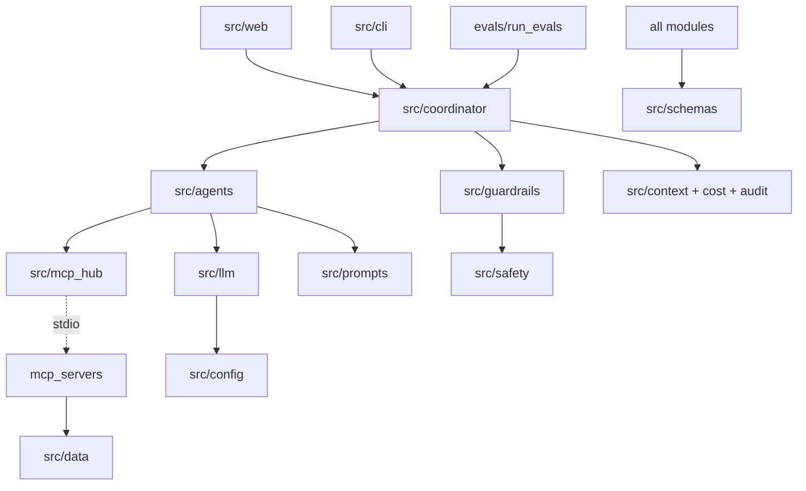

# TriageDesk - Project Structure (v1.0)

| | |
|---|---|
| **Status** | Final for v1.0 (Day 2, revision 1.1) |
| **Replaces** | Blueprint A4 (`it-triage-agent/` layout). The repository is named `triagedesk`; A4 is updated to match |
| **Legend** | `[exists]` already in the repo after Day 2; `[Day N]` created on that day; `[gen]` generated at runtime, git-ignored |

---

## 1. Full tree (end of Day 14)

```text
triagedesk/
├── README.md                     [exists, rewritten Day 14]  what it is, results table, demo link, run steps
├── CLAUDE.md                     [exists, Day 11 extended]   rules for Claude Code in this repo
├── LICENSE                       [Day 14]                    MIT
├── Dockerfile                    [Day 13]                    image for Render
├── .dockerignore                 [Day 13]
├── render.yaml                   [Day 13]                    Render service definition
├── .env.example                  [exists]                    every variable, no secrets
├── .gitignore  .gitattributes    [exists]                    LF line endings (ADR-021)
├── .mcp.json                     [Day 11]                    project-scoped MCP servers for Claude Code
├── pyproject.toml                [exists]                    pytest and ruff settings
├── requirements.txt              [exists]                    pinned minimums (mcp<2, ADR-011)
│
├── .claude/
│   ├── settings.json             [Day 11]                    permissions and hook
│   └── commands/
│       ├── run-evals.md          [Day 11]
│       └── triage-sample.md      [Day 11]
├── .vscode/settings.json         [exists]                    pytest + ruff, no OS-specific paths
│
├── docs/
│   ├── PRD.md                    [exists]                    requirements (what and why)
│   ├── 09-implementation-blueprint.md [exists]               day-by-day plan; single source of truth
│   ├── ARCHITECTURE.md  SCHEMA.md  API.md                    [exists] Day 2 design set
│   ├── UI-WIREFRAMES.md  PROJECT-STRUCTURE.md                [exists] Day 2 design set
│   ├── PROJECT-LOG.md            [exists]                    one entry per day (hours, done, blockers)
│   ├── 00-scope.md ... 08-project-plan.md                    [exists] Day 1 planning docs (banners added)
│   ├── 04-decision-log.md        [exists]                    ADRs; appended when a decision changes
│   ├── 10-traceability.md        [Day 13, generated]         requirement -> code -> test
│   ├── handoff/day-02.md ... day-14.md                       [one per day] state for the next day's chat
│   └── assets/                   [Days 12-14]                screenshots, demo GIF
│
├── data/                         [exists]                    reference data (read-only at runtime)
│   ├── users.json  resources.json  access.json  kb.json  pricing.json
│   └── tickets_seed.json         [Day 4]                     initial ITSM tickets
│
├── mcp_servers/                  MCP servers (stdio). Never print to stdout
│   ├── hello_server.py  hello_client.py   [exists]           Day 1 learning example
│   ├── common.py                 [Day 3]                     ok()/err() envelope helpers
│   ├── directory_logic.py        [Day 3]                     pure functions (no MCP import)
│   ├── directory_server.py       [Day 3]                     get_user, find_resource, check_access
│   ├── itsm_logic.py             [Day 4]                     pure functions + in-memory ticket store
│   └── itsm_server.py            [Day 4]                     search_kb, get_ticket, update_ticket, add_comment
│
├── src/
│   ├── __init__.py               [exists]
│   ├── config.py                 [exists]                    Settings from environment
│   ├── schemas.py                [exists]                    every Pydantic model and enum
│   ├── data.py                   [Day 3]                     JSON loaders and eligibility helper
│   ├── safety.py                 [Days 6-7]                  injection/secret/security-term detectors, redaction
│   ├── guardrails.py             [Day 7]                     G1-G7 and the pre-tool check; pure functions
│   ├── llm.py                    [Day 5]                     Anthropic wrapper: retries, caching, forced tools
│   ├── mcp_hub.py                [Day 5]                     starts both servers once, routes tool calls
│   ├── context.py                [Day 9]                     thread summarisation and token budget
│   ├── cost.py                   [Day 9]                     token to dollar maths from data/pricing.json
│   ├── audit.py                  [Day 9]                     JSONL audit log (redacted)
│   ├── coordinator.py            [Day 8]                     triage(): the single entry point
│   ├── cli.py                    [Day 8]                     python -m src.cli
│   ├── prompts/
│   │   ├── __init__.py  render.py                            render_ticket(): the only way ticket text enters a prompt
│   │   └── classifier.py  diagnostics.py  resolver.py  summarizer.py
│   ├── agents/
│   │   ├── __init__.py           [exists]
│   │   └── classifier.py  diagnostics.py  resolver.py        [Days 5-8]
│   └── web/                      [Day 12]
│       ├── __init__.py  app.py  limits.py
│       └── static/ index.html  app.js  style.css
│
├── evals/
│   ├── tickets.jsonl             [Days 6-10]                 43 labelled tickets (8 public)
│   ├── labels-notes.md  FAILURES.md  iterations.md           [Days 10-11]
│   ├── metrics.py  run_evals.py  classify_only.py            [Day 10]
│   └── reports/                  [gen]                       committed run summaries only
│
├── scripts/                      opt-in tools; may cost money
│   ├── check.py                  [Day 3]                     lint + tests + data checks in one command
│   ├── cache_check.py  smoke_*.py                            [Days 5-9] live checks
│   └── traceability.py           [Day 13]
│
├── tests/                        offline only; never call the real API
│   ├── fakes.py  conftest.py     [Day 5]                     FakeLLM, FakeHub
│   ├── test_schemas.py  test_config.py  test_data_integrity.py   [exists]
│   └── test_*.py                 [Days 3-12]                 one file per module
│
└── logs/                         [gen, git-ignored]          audit.jsonl
```

## 2. Folder responsibilities

| Folder | Owns | Must not contain |
|--------|------|------------------|
| `src/` | Application logic: pipeline, agents, guardrails, wrappers | Web framework code outside `src/web/`; hard-coded model names or thresholds |
| `src/agents/` | One model-facing role per file (classifier, diagnostics, resolver) | Policy decisions; those live in `guardrails.py` |
| `src/prompts/` | Prompt text and `render_ticket()` | Logic or I/O |
| `src/web/` | HTTP layer, abuse limits, static page | Business rules; it only calls `triage()` |
| `mcp_servers/` | Tools exposed over MCP; logic split from transport so it is unit-testable | Imports from `src/` except `schemas`/`data` where noted; any `print` to stdout |
| `data/` | Mock reference data | Real personal data; secrets |
| `evals/` | Labelled tickets, metrics, runner (the only code that spends money on purpose) | Unit tests |
| `tests/` | Offline unit and integration tests with fakes | Real API calls |
| `scripts/` | Opt-in developer tools and live smoke checks | Application logic |
| `docs/` | All documentation and daily handoffs | Generated secrets or logs |

## 3. Dependency rules (enforced by review and by import tests)



1. Dependencies point downward only. `schemas.py` and `config.py` import nothing from the rest of the app.
2. `guardrails.py` and `safety.py` are pure (no I/O, no network, no model), so they can be tested exhaustively.
3. Only `llm.py` talks to the Anthropic SDK; only `mcp_hub.py` talks to MCP servers. Everything else is testable with fakes.
4. `web/`, `cli.py` and `evals/` are thin callers of `triage()`; none contains decision logic.
5. MCP servers contain no model calls.

## 4. Where future code goes (day to file)

| Day | New files | Modified |
|-----|-----------|----------|
| 3 | `src/data.py`, `mcp_servers/common.py`, `directory_logic.py`, `directory_server.py`, `scripts/check.py`, tests | `docs/handoff/day-03.md` |
| 4 | `itsm_logic.py`, `itsm_server.py`, `data/tickets_seed.json`, tests | - |
| 5 | `src/llm.py`, `src/mcp_hub.py`, `src/agents/diagnostics.py`, `tests/fakes.py`, `conftest.py` | `pyproject.toml` (live marker) |
| 6 | `src/prompts/*`, `src/agents/classifier.py`, `src/safety.py` (detectors), `evals/tickets.jsonl` (EV-001..019) | - |
| 7 | `src/guardrails.py`, secret scan in `safety.py` | `evals/tickets.jsonl` |
| 8 | `src/agents/resolver.py`, `src/coordinator.py`, `src/cli.py` | `evals/tickets.jsonl` |
| 9 | `src/context.py`, `src/cost.py`, `src/audit.py` | `src/coordinator.py` |
| 10 | `evals/metrics.py`, `run_evals.py`, `classify_only.py` | `evals/tickets.jsonl` (to 43) |
| 11 | `.claude/*`, `.mcp.json`, `evals/FAILURES.md` | prompts and guardrails as needed |
| 12 | `src/web/*`, `tests/test_web.py`, `test_limits.py` | `README.md` |
| 13 | `Dockerfile`, `.dockerignore`, `render.yaml`, `scripts/traceability.py`, `docs/10-traceability.md` | - |
| 14 | `LICENSE`, `docs/assets/*` | `README.md`, `docs/PROJECT-LOG.md` |

## 5. Configuration files

| File | Purpose |
|------|---------|
| `pyproject.toml` | pytest (`asyncio_mode=auto`, function-scoped loops), ruff (lint + format) |
| `requirements.txt` | Runtime and dev dependencies; `mcp[cli]>=1.2,<2` |
| `.env.example` | Names and defaults for every setting; copied to `.env` locally (never committed) |
| `.gitattributes` | `* text=auto eol=lf` so Windows and Linux agree (ADR-021) |
| `.gitignore` | `.env`, `.venv`, `logs/`, caches |
| `.vscode/settings.json` | Enables pytest and ruff; no OS-specific interpreter path |

## 6. Why this structure

- **Contracts first.** `schemas.py` and `data/` exist before any behaviour, so every later day builds to a tested shape.
- **Logic separated from transport.** `*_logic.py` files hold pure functions; `*_server.py` files are thin MCP wrappers. Most testing needs no subprocess.
- **One entry point.** `triage()` is called identically by the CLI, the evals and the web app, so what is measured is what is demoed.
- **Money is opt-in.** Only `evals/` and `scripts/smoke_*.py` can call the API; `pytest` is free and offline.
- **Flat and small.** About 20 source modules, each under a few hundred lines, so a reviewer can read the whole system in an hour.
- **Docs next to code.** Every day ends with a handoff file, so a fresh conversation can resume without re-planning.
