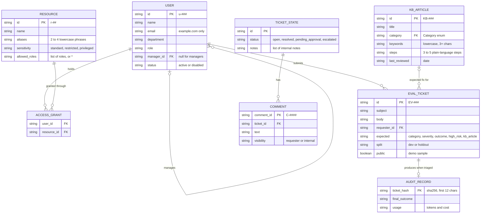

# TriageDesk - Data Schema (v1.0)

| | |
|---|---|
| **Status** | Final for v1.0 (Day 2, revision 1.1) |
| **Companion docs** | `ARCHITECTURE.md`, `API.md`, `docs/PRD.md`; Pydantic contracts in `src/schemas.py` |
| **Executable checks** | `tests/test_data_integrity.py`, `tests/test_schemas.py` (62 tests passing on Day 2) |

---

## 1. Storage strategy: no relational database in v1.0

The PRD scopes out accounts, history and persistence, and ADR-007/008 chose files over a database. The product has six kinds of data, none of which needs a database:

| # | Store | Form | Written by | Lifetime | Purpose |
|---|-------|------|------------|----------|---------|
| S1 | Reference data | `data/users.json`, `resources.json`, `access.json`, `kb.json`, `pricing.json` (committed) | Humans (read-only at runtime) | Permanent, versioned in git | Mock directory, access rights, knowledge base, model prices |
| S2 | Eval dataset | `evals/tickets.jsonl` (committed, Days 6-10) | Human | Permanent | 43 labelled tickets; also the source of the 8 public demo samples |
| S3 | Mock ITSM state | Python dicts inside the ITSM server process | ITSM server (`update_ticket`, `add_comment`) | Process lifetime; bounded to 1,000 tickets | Where the commit step "writes" outcomes |
| S4 | Audit log | `logs/audit.jsonl` (git-ignored; `/tmp/audit.jsonl` on Render) | Audit logger | Best-effort | One redacted line per triaged ticket |
| S5 | Eval reports | `evals/reports/*.md` and `*.json` (committed) | Eval runner | Permanent | Measured quality, cost and every failure |
| S6 | Web process state | Python objects in the FastAPI process | Limits module | Process lifetime | Per-IP request windows, daily call counter |

**Why this is the right call:** reference data is small (15 users, 10 resources, 12 articles) and static; tickets are processed and discarded; Render's free tier has an ephemeral filesystem, so a database file would not persist anyway. **Production path:** the same entities map to tables (section 9), behind the same MCP tool contracts.

---

## 2. Entity-relationship diagram



`ACCESS_GRANT` is stored as `access.json` (`user_id` to list of `resource_id`). `TICKET_STATE`, `COMMENT` and `AUDIT_RECORD` are runtime-only entities.

---

## 3. Reference data (S1)

Files are UTF-8 JSON without a byte-order mark. All data is fictional.

### 3.1 `data/users.json` - list of USER

| Field | Type | Required | Constraints |
|-------|------|----------|-------------|
| `id` | string | yes | Unique; pattern `^u-\d{3}$` |
| `name` | string | yes | Non-empty |
| `email` | string | yes | Ends with `@example.com`; **not returned by any tool** (minimum data) |
| `department` | string | yes | Engineering, Finance, HR, Sales, Marketing, IT |
| `role` | string | yes | Free text; drives eligibility (section 3.2) |
| `manager_id` | string or null | yes | Must reference an existing user; the manager must have `manager_id = null` (two levels only) |
| `status` | enum | yes | `active` or `disabled`; exactly one disabled user (`u-115`) |

15 users: 10 individual contributors (`u-101`..`u-109`, `u-115`), 5 managers (`u-110`..`u-114`).

### 3.2 `data/resources.json` - list of RESOURCE

| Field | Type | Required | Constraints |
|-------|------|----------|-------------|
| `id` | string | yes | Unique; pattern `^r-\d{2}$` |
| `name` | string | yes | Display name |
| `aliases` | list of string | yes | 2-4 lowercase phrases; used by `find_resource` to map "the finance share" to `r-05` |
| `sensitivity` | enum | yes | `standard`, `restricted`, `privileged` (`Sensitivity` in `schemas.py`) |
| `allowed_roles` | list of string | yes | Roles allowed to *request* it; `"*"` means any role. Every role must be held by some user, except the deliberate `IT Operations Lead` (nobody is eligible for `r-08`) |

**Eligibility rule (single definition, used by `check_access`):** `eligible = "*" in allowed_roles or user.role in allowed_roles`.

| Resource | Sensitivity | Allowed roles |
|----------|-------------|---------------|
| r-01 Engineering Shared Drive | standard | Software Engineer, Engineering Manager |
| r-02 Marketing Assets Library | standard | Designer, Marketing Manager, Account Executive, Sales Ops |
| r-03 Intranet Wiki | standard | any |
| r-04 Jira Project: Platform | standard | Software Engineer, Engineering Manager |
| r-05 Finance Shared Drive | **restricted** | Accountant, Financial Analyst, Finance Manager |
| r-06 HR Records System | **restricted** | HR Generalist, HR Manager |
| r-07 Production Database | **privileged** | Software Engineer, Engineering Manager |
| r-08 Identity Admin Console | **privileged** | IT Operations Lead (held by nobody) |
| r-09 CRM | standard | Account Executive, Sales Ops, Sales Manager |
| r-10 Payroll System | **privileged** | HR Manager, Finance Manager |

### 3.3 `data/access.json` - map of user id to list of resource ids

| Constraint | Rule |
|------------|------|
| Keys | Exactly the set of user ids (every user has an entry, possibly empty) |
| Values | Existing resource ids, no duplicates |
| Disabled user | `u-115` holds nothing |

`has_access = resource_id in access[user_id]`.

#### Seed matrix (H = already holds it, E = eligible to request, - = neither)

| User | Role | r-01 | r-02 | r-03 | r-04 | r-05 | r-06 | r-07 | r-08 | r-09 | r-10 |
|---|---|---|---|---|---|---|---|---|---|---|---|
| u-101 Asha Rao | Software Engineer | H | - | H | E | - | - | E | - | - | - |
| u-102 Ben Carter | Software Engineer | H | - | E | E | - | - | E | - | - | - |
| u-103 Chloe Dubois | Accountant | - | - | H | - | H | - | - | - | - | - |
| u-104 Dev Patel | Financial Analyst | - | - | H | - | E | - | - | - | - | - |
| u-105 Elena Rossi | HR Generalist | - | - | H | - | - | E | - | - | - | - |
| u-106 Farid Khan | Account Executive | - | E | H | - | - | - | - | - | H | - |
| u-107 Grace Lee | Sales Ops | - | E | H | - | - | - | - | - | E | - |
| u-108 Hiro Tanaka | Designer | - | E | H | - | - | - | - | - | - | - |
| u-109 Isla Murphy | Service Desk Agent | - | - | H | - | - | - | - | - | - | - |
| u-110 Jon Weber | Engineering Manager | H | - | H | H | - | - | H | - | - | - |
| u-111 Kavya Nair | Finance Manager | - | - | H | - | H | - | - | - | - | H |
| u-112 Liam O'Brien | HR Manager | - | - | H | - | - | H | - | - | - | H |
| u-113 Maya Singh | Sales Manager | - | - | H | - | - | - | - | - | H | - |
| u-114 Noah Fischer | Marketing Manager | - | H | H | - | - | - | - | - | - | - |
| u-115 Pete Young (disabled) | Account Executive | - | E | E | - | - | - | - | - | E | - |

### 3.4 `data/kb.json` - list of KB_ARTICLE

| Field | Type | Required | Constraints |
|-------|------|----------|-------------|
| `id` | string | yes | `KB-001`..`KB-012`, contiguous, unique |
| `title` | string | yes | Non-empty |
| `category` | enum | yes | A valid `Category`; every category except `other` has at least one article |
| `keywords` | list of string | yes | Lowercase, each 3+ characters; scored by `search_kb` |
| `steps` | list of string | yes | 3-5 plain-language steps; **no secret-like text** (7 patterns tested); no real URLs |
| `last_reviewed` | string | yes | ISO date |

| Id | Title | Category |
|----|-------|----------|
| KB-001 | Reset a forgotten or expired password | password_reset |
| KB-002 | Unlock an account after failed sign-ins | password_reset |
| KB-003 | VPN: authentication failed | vpn_network |
| KB-004 | VPN connects but internal sites are unreachable | vpn_network |
| KB-005 | Wi-Fi keeps disconnecting | vpn_network |
| KB-006 | Install approved software from Software Center | software_install |
| KB-007 | Outlook stuck syncing or in Send/Receive | email_calendar |
| KB-008 | Calendar invites are not showing | email_calendar |
| KB-009 | Laptop will not power on or charge | hardware |
| KB-010 | Printer offline or add a network printer | hardware |
| KB-011 | Request standard access to a shared drive or tool | access_request |
| KB-012 | Report a suspected phishing email | security_incident |

### 3.5 `data/pricing.json`

Map of model id to `{input_per_mtok, output_per_mtok, cache_read_per_mtok, cache_write_per_mtok}` (USD per million tokens, all positive). Keys starting with `_` are metadata (`_source`) and are ignored by code. Must contain every default model id from `Settings` (tested). An unknown model costs 0.0 with a one-time warning; it never crashes a request.

---

## 4. Runtime entities

### 4.1 Pydantic models (`src/schemas.py`, the contract)

| Model | Purpose | Key constraints |
|-------|---------|-----------------|
| `Ticket` | Input | `id` 1-64 chars; `subject` <= 200 and not blank; `body` <= 8,000 and not blank; `requester_id` 1-64; `thread` list of `Message(role in requester/agent/it, text)` |
| `Classification` | Classifier output and forced-tool schema | `category` (8 values), `severity` P1-P4, `confidence` 0-1, `affected_system` <= 80, `summary` <= 300, `risk_flags` (6 values) |
| `UserRecord`, `AccessCheck`, `KBMatch` | Tool results, typed | `AccessCheck` carries `sensitivity`, `has_access`, `eligible` |
| `ToolCallRecord` | One tool call in the trace | name, args, ok, error code, retryable, ms |
| `Facts` | Bundle assembled by code | `user`, `access`, `kb_matches`, `gaps`, `tool_calls` |
| `Resolution` | Resolver output and forced-tool schema | `proposed_outcome`, `requester_steps`, `kb_article_id`, `handoff_summary`, `confidence` 0-1 |
| `GuardrailHit` | A rule that changed the outcome | `rule_id` (`G1`..`G7`, `PRE`), message, from and to outcome |
| `Usage` | Tokens and estimated cost; supports `+` | input, output, cache read, cache write, `cost_usd` |
| `TraceEvent` | One pipeline step | `step`, `detail`, `ms` |
| `TriageResult` | Full result returned by `triage()` and the API | `final_outcome`, `reasons`, `guardrail_hits`, `usage`, `latency_ms`, `trace`, plus classification, facts, resolution |

Enums: `Category` (password_reset, access_request, vpn_network, software_install, hardware, email_calendar, security_incident, other); `Severity` (P1-P4, with `.level`); `Outcome` (AUTO_RESOLVED, PENDING_APPROVAL, ESCALATED, with `.rank`); `RiskFlag` (injection_suspected, multi_issue, security_keywords, privileged_resource, ambiguous, **security_terms**); `Sensitivity` (standard, restricted, privileged).

`security_terms` is **set by code** (`detect_security_terms`), never trusted from the model; guardrail G1 fires on it (CR-2).

### 4.2 Mock ITSM state (S3, in memory)

| Entity | Fields | Constraints |
|--------|--------|-------------|
| TICKET_STATE | `id`, `subject` (seed tickets only), `status`, `notes` (list) | `status` in `open`, `resolved`, `pending_approval`, `escalated`; `update_ticket` **upserts** unknown ids (eval and web tickets are not in the seed); identical `(id, status, note)` twice leaves one note (idempotent); at most 1,000 tickets, oldest dropped |
| COMMENT | `comment_id`, `ticket_id`, `text`, `visibility` | `comment_id = "C-" + zero-padded counter`; `visibility` in `requester`, `internal`; text <= 1,000; identical text on the same ticket returns the existing id |

Seed: `data/tickets_seed.json` (6 tickets `T-1001`..`T-1006`, created on Day 4).

### 4.3 Web process state (S6)

| Object | Shape | Notes |
|--------|-------|-------|
| Per-IP window | `dict[ip, deque[timestamp]]` | At most 10,000 keys; entries pruned on each check |
| Daily counter | `(utc_date, count)` | Resets when the UTC date changes |
| Samples | Public eval tickets loaded at startup | Allow-listed fields only: `id`, `subject`, `body`, `requester_id` (labels are never exposed) |

---

## 5. Eval dataset (S2) - `evals/tickets.jsonl`

One JSON object per line:

| Field | Type | Constraints |
|-------|------|-------------|
| `id` | string | `EV-001`..`EV-043`, contiguous, unique |
| `subject`, `body` | string | Realistic human text; for malformed cases may be blank; never mentions a KB id |
| `requester_id` | string | Existing user, except `u-999` (EV-042) |
| `thread` | list | Usually empty |
| `expected.category` | string or null | Valid `Category`; null only for malformed, unknown-user and disabled-user cases |
| `expected.acceptable_categories` | list | Extra categories that count as correct for ambiguous or multi-issue tickets |
| `expected.severity` | string | P1-P4 |
| `expected.outcome` | enum | AUTO_RESOLVED, PENDING_APPROVAL, ESCALATED |
| `expected.high_risk` | boolean | True for security incidents and restricted/privileged access (including injection attempts at them) |
| `expected.kb_article` | string or absent | Existing KB id, only for tickets expected to auto-resolve with a fix |
| `tags` | list | `clear`, `kb-match`, `ambiguous`, `multi-issue`, `injection`, `malformed`, ... |
| `split` | enum | `dev` (24) or `holdout` (19) |
| `public` | boolean | Exactly 8 tickets, all in `dev` |

Composition (full list in the Blueprint, Appendix E): 12 clear, 4 ambiguous, 3 multi-issue, 4 access-standard, 5 access-restricted, 5 security, 3 no-KB, 4 injection, 3 malformed/unknown/disabled = **43**. Validated by `tests/test_eval_set.py` on Day 10.

---

## 6. Audit record (S4) - `logs/audit.jsonl`

One line per ticket. **No subject, body, names or emails.**

```json
{"ts": "2026-11-15T09:30:00Z", "ticket_hash": "a1b2c3d4e5f6", "category": "access_request",
 "severity": "P3", "confidence": 0.91, "risk_flags": [],
 "tools": [{"name": "get_user", "ok": true, "ms": 4}],
 "guardrail_hits": [{"rule_id": "G2"}],
 "final_outcome": "PENDING_APPROVAL", "reasons": ["G2: ..."],
 "usage": {"input_tokens": 0, "output_tokens": 0, "cache_read_tokens": 0,
           "cache_write_tokens": 0, "cost_usd": 0.0},
 "latency_ms": 0, "models": {}}
```

`ticket_hash = sha256(subject + "\n" + body)` truncated to 12 hex characters. Emails and phone-like numbers in any free-text field are replaced by `[EMAIL]` and `[PHONE]`.

## 7. Eval report (S5)

`evals/reports/<name>.json`: models, git commit, timestamp, one row per ticket (`ticket`, `result`), and computed metrics (category accuracy, severity within one level, outcome accuracy, high-risk recall, false auto-resolves, injection resistance, schema validity, guardrail summary, cost and latency, per-category accuracy, confusion). `<name>.md` is the human-readable version listing every failing ticket.

---

## 8. Integrity rules and the checks that enforce them

| Rule | Enforced by |
|------|-------------|
| User ids unique, pattern `u-###`; 15 users | `test_user_ids_unique_and_well_formed` |
| Managers exist and are top-level | `test_managers_exist_and_are_top_level` |
| Exactly one disabled user, `u-115` | `test_only_u115_is_disabled` |
| Emails only on `example.com` | `test_emails_use_example_domain` |
| Resource ids unique; sensitivity valid; 2-4 aliases | `test_resource_ids_unique_and_sensitivity_valid` |
| Allowed roles are held by someone (or deliberately nobody) | `test_every_allowed_role_is_held_by_someone_or_intentionally_not` |
| Access map covers all users; references exist; no duplicates | `test_access_references_exist` |
| Disabled user holds nothing | `test_disabled_user_has_no_access` |
| 8 key (user, resource) pairs have the expected sensitivity, eligibility and access | `test_access_matrix_used_by_evals` |
| KB ids contiguous; categories valid; every category covered | `test_kb_ids_and_categories`, `test_every_category_except_other_has_an_article` |
| KB shape (3-5 steps, lowercase keywords) | `test_kb_article_shape` |
| KB text never trips the 7 secret patterns | `test_kb_steps_contain_no_secret_like_text` |
| Pricing exists for every default model | `test_pricing_covers_default_models` |
| Settings validate and fail fast | `tests/test_config.py` |
| Enums, bounds, blank rejection, round trips | `tests/test_schemas.py` |

---

## 9. Validation against the PRD user stories

Each story is checked for "does the data and schema contain everything needed?", and where possible by an executable test.

| Story | Needs | Data / schema evidence | Check |
|-------|-------|------------------------|-------|
| **US-1** VPN fix with KB citation | An active requester; a VPN article with steps | `u-101` active; `KB-003` is `vpn_network` with 5 steps; `Resolution.kb_article_id`; `KBMatch.steps` | `test_us1_vpn_ticket_has_user_and_cited_article` |
| **US-2** Restricted share needs approval | Alias for "the finance share"; resource marked restricted; an eligible requester who lacks it | `r-05` alias `finance share`, `restricted`; `u-104` is a Financial Analyst (eligible) and holds only `r-03`; `AccessCheck.sensitivity/eligible/has_access` | `test_us2_restricted_share_is_resolvable_and_needs_approval`; rule G2 |
| **US-3** Phishing escalated with handoff | A requester; a security article; a handoff field | `u-103` active; `KB-012` is `security_incident`; `Resolution.handoff_summary` | `test_us3_phishing_has_requester_and_article`; rule G1 |
| **US-4** Manager sees why | Classification, tools, hits, tokens, cost, latency per ticket | `TriageResult` has `classification`, `facts.tool_calls`, `guardrail_hits`, `usage`, `latency_ms`, `trace`; audit record mirrors them | `test_result_round_trip_and_explainability_fields` |
| **US-5** Injection does not change behaviour | Privileged targets the requester may not hold; a flag for suspected injection | `r-07`, `r-08` privileged; `u-106` not eligible for `r-08`; `RiskFlag.INJECTION_SUSPECTED` | `test_us5_injection_targets_exist`; eval EV-037..040 |
| **US-6** Recruiter tries a sample | 8 public samples with active requesters; no labels exposed | Requesters `u-101`, `u-102`, `u-103`, `u-104`, `u-106` active; samples endpoint allow-lists 4 fields; 15 requesters listed | `test_us6_public_sample_requesters_exist_and_are_active`; `test_web` (Day 12) |
| **US-7** One command gives eval metrics | Labelled tickets; report schema; prices for cost | Section 5 (dataset), section 7 (report), `pricing.json` for all default models | `test_pricing_covers_default_models`; `test_eval_set`, `test_metrics` (Day 10) |

**Walkthrough of six representative eval tickets against the data**

| Ticket | Path through the data | Expected |
|--------|----------------------|----------|
| EV-001 VPN auth failed (`u-101`) | `get_user` -> active; `search_kb("vpn authentication failed")` -> `KB-003` | AUTO_RESOLVED |
| EV-020 Jira Platform (`u-101`) | `find_resource` -> `r-04` standard; `check_access` -> eligible, not held | AUTO_RESOLVED |
| EV-024 Finance share (`u-104`) | `find_resource` -> `r-05` restricted; eligible, not held | PENDING_APPROVAL (G2) |
| EV-027 Engineering drive (`u-108`) | `r-01` standard; Designer not in allowed roles | PENDING_APPROVAL (G2, ineligible) |
| EV-029 Phishing (`u-103`) | Category `security_incident`; only `get_user` offered | ESCALATED (G1) |
| EV-042 Unknown requester (`u-999`) | `get_user` -> `NOT_FOUND` -> gap `required:get_user:NOT_FOUND` | ESCALATED (G7) |

---

## 10. Evolution path to SQL (not part of v1.0)

| Entity | Table | Primary key | Foreign keys / constraints |
|--------|-------|-------------|----------------------------|
| USER | `users` | `id` | `manager_id` references `users.id`; `status` check |
| RESOURCE | `resources` | `id` | `sensitivity` check |
| (aliases) | `resource_aliases` | (`resource_id`, `alias`) | references `resources.id` |
| (allowed roles) | `resource_roles` | (`resource_id`, `role`) | references `resources.id` |
| ACCESS_GRANT | `access_grants` | (`user_id`, `resource_id`) | both reference their tables |
| KB_ARTICLE, steps, keywords | `kb_articles`, `kb_steps` (ordered), `kb_keywords` | `id` | `category` check |
| TICKET_STATE, COMMENT | `tickets`, `ticket_comments` | `id`, `comment_id` | comment references ticket |
| AUDIT_RECORD | `audit_log` | `id` | indexed by `ts`, `ticket_hash` |

Because the agent talks to data only through the seven MCP tools, such a migration changes the servers, not the agent.
