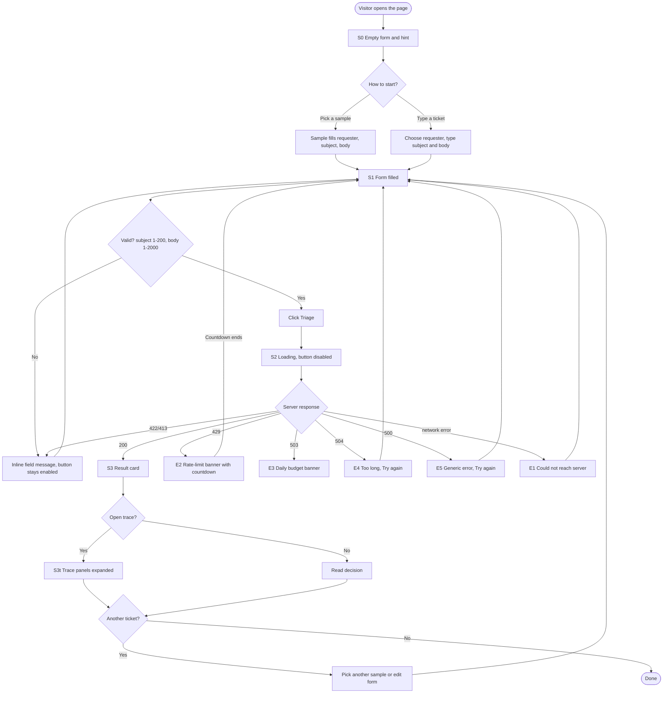
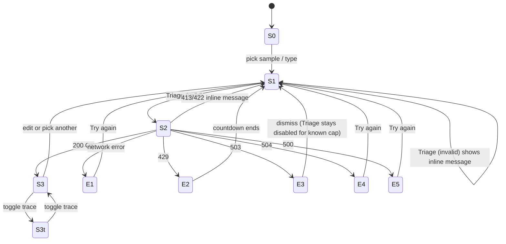

# TriageDesk - UI, User Flow and Low-Fidelity Wireframes (v1.0)

| | |
|---|---|
| **Status** | Final for v1.0 (Day 2, revision 1.1). No UI code exists yet; this is the contract for Day 12 |
| **Scope** | One static page served at `/`, plus the trace view on that same page |
| **Companion docs** | `API.md` (endpoints, error codes), `SCHEMA.md` (`TriageResult`), `ARCHITECTURE.md` |
| **Stack** | Plain HTML, CSS and vanilla JavaScript. No framework, no build step, no `innerHTML` (all text via `textContent`) |

---

## 1. Goals of the UI

The UI exists for one job: let a reviewer (recruiter, hiring manager, engineer) **try the agent in under 60 seconds and see why it decided what it decided**. Everything on screen serves one of these four purposes. Anything that does not is out of scope.

| # | Purpose | Where it is served |
|---|---------|--------------------|
| P1 | Run a ticket with zero typing | Sample picker (screen S0/S1) |
| P2 | Run a custom ticket safely | Requester dropdown, subject, body, counter |
| P3 | Understand the decision at a glance | Result card with outcome badge |
| P4 | Verify the decision (trust) | Trace view: steps, tool calls, guardrail hits, cost |

---

## 2. Screens and why each exists

There is **one page** with **one workspace** and five states. There are no routes, logins or modals. A "screen" below means a distinct visual state of that page.

| ID | Screen / state | Reason it exists (what the user needs) |
|----|----------------|----------------------------------------|
| S0 | Empty (first load) | Orient the visitor: what this is, that data is mock, how to start. Shows the form and an empty result area with a hint |
| S1 | Form filled (sample chosen or typed) | Let the visitor review or edit the ticket before spending a model call |
| S2 | Loading | Triage takes 10-25 s; the visitor must know it is working and must not double-submit |
| S3 | Result (success) | Show the decision (outcome, category, severity, confidence), the message or handoff, and the reasons |
| S3t | Result with trace open | Show how the decision was made: pipeline steps, tool calls, guardrail hits, tokens and cost |
| E1-E5 | Error states | Every failure from `API.md` section 4 gets a clear message and, where useful, a way forward |

Not included, on purpose: login, history, admin, ticket list, settings, dark mode toggle, charts. They add effort and do not serve P1-P4.

---

## 3. User flow



## 4. Screen (state) flow



---

## 5. Layout and navigation

Navigation is deliberately minimal: **no menu**. The page has a header with the product name and a fixed "demo system - mock data" label, a link to the GitHub repository, and a link to the README. Two columns on wide screens (form left, result right); one column on narrow screens (form, then result). Breakpoint: 720 px.

Keyboard order (top to bottom, left to right): header links, sample dropdown, requester dropdown, subject, body, Triage button, then the result region and each trace `<details>` summary in order.

---

## 6. Wireframes (low fidelity)

Legend: `[ ... ]` input, `( ... )` button, `[v]` dropdown, `{...}` badge, `...` placeholder text.

### 6.1 Desktop, S0 (first load)

```text
+--------------------------------------------------------------------------------+
| TriageDesk      IT incident triage agent       {demo system - mock data}       |
|                                                       GitHub | README          |
+--------------------------------------------------------------------------------+
| 1. Choose a ticket                          | Result                           |
|                                             |                                  |
| Sample ticket  [ Pick a sample...        v] |   Nothing yet.                   |
| Requester      [ Choose a requester...   v] |   Pick a sample ticket on the    |
| Subject        [__________________________] |   left, or write your own, then  |
| Body           [                          ] |   press Triage.                  |
|                [                          ] |                                  |
|                [__________________________] |   The agent classifies the       |
|                                  0 / 2000   |   ticket, checks the mock        |
|                                             |   directory and knowledge base,  |
| ( Triage )                                  |   applies safety rules, and      |
|                                             |   shows every step it took.      |
| Runs on mock data. Do not enter real        |                                  |
| personal or company information.            |                                  |
+--------------------------------------------------------------------------------+
| Each run calls a paid model; demo limits apply (5 per minute per visitor).     |
+--------------------------------------------------------------------------------+
```

### 6.2 Desktop, S3t (result with trace open)

```text
+--------------------------------------------------------------------------------+
| TriageDesk      IT incident triage agent       {demo system - mock data}       |
+--------------------------------------------------------------------------------+
| 1. Choose a ticket                          | Result                           |
| Sample   [ Need access to finance share  v] | {PENDING_APPROVAL}  <- text+color|
| Requester[ Dev Patel (Financial Analyst) v] | access_request | P3 | conf 0.90  |
| Subject  [Need access to the finance sha..] | Affected: Finance Shared Drive   |
| Body     [Hi, I am starting on the quarte..] |                                  |
|          [...                             ] | Handoff to service desk          |
|                                  118 / 2000 | Dev Patel (Financial Analyst)    |
| ( Triage )                                  | requests the Finance Shared      |
|                                             | Drive, a restricted resource...  |
|                                             |                                  |
|                                             | Why this outcome                 |
|                                             |  - G2: restricted resource ->    |
|                                             |    approval required             |
|                                             |                                  |
|                                             | v Trace (6 steps)                |
|                                             |  [validate]  1 ms                |
|                                             |  [classify]  1,400 ms            |
|                                             |  [diagnose]  6,100 ms  v         |
|                                             |    tool      args        ok  ms  |
|                                             |    get_user  u-104       yes  5  |
|                                             |    find_res. finance..   yes  4  |
|                                             |    check_acc u-104,r-05  yes  4  |
|                                             |  [resolve]   3,200 ms            |
|                                             |  [guardrails] G2: AUTO ->        |
|                                             |               PENDING_APPROVAL   |
|                                             |  [commit]    12 ms               |
|                                             |  Totals: 13,500 in / 900 out     |
|                                             |  tokens | $0.03 | 14.2 s         |
+--------------------------------------------------------------------------------+
```

### 6.3 Desktop, S3 for an auto-resolved ticket (requester message)

```text
| Result                                                                          |
| {AUTO_RESOLVED}                                                                 |
| vpn_network | P3 | conf 0.94                                                    |
|                                                                                 |
| Message to requester (from KB-003)                                              |
|  1. Open the VPN client and choose Sign out.                                    |
|  2. Restart the client and sign in again with your current password.            |
|  3. If prompted for MFA, approve the request on your phone.                     |
|                                                                                 |
| Why this outcome                                                                |
|  - No guardrail raised the outcome.                                             |
| > Trace (6 steps)                                                               |
```

### 6.4 Phone (under 720 px), single column

```text
+--------------------------+
| TriageDesk               |
| {demo system - mock data}|
+--------------------------+
| Sample ticket            |
| [ Pick a sample...    v] |
| Requester                |
| [ Choose...           v] |
| Subject                  |
| [______________________] |
| Body                     |
| [                      ] |
| [______________________] |
|              0 / 2000    |
| ( Triage )               |
+--------------------------+
| Result                   |
| {ESCALATED}              |
| security_incident | P1   |
| conf 0.97                |
| Handoff to service desk  |
| ...                      |
| > Trace (6 steps)        |
+--------------------------+
```

### 6.5 Loading (S2) and errors (E1-E5)

```text
S2 Loading                       E2 Rate limited (429)
+----------------------------+   +--------------------------------------------+
| ( Triaging... ) disabled   |   | ! Too many requests. Try again in 41 s.    |
| Result: spinner + "Working |   | ( Triage ) disabled until the timer ends   |
| on it. This usually takes  |   +--------------------------------------------+
| 10-25 seconds."            |
+----------------------------+   E3 Daily cap (503)
                                 +--------------------------------------------+
E1 Network error                 | ! The demo's daily budget is used up. It   |
+----------------------------+   | resets at 00:00 UTC. See the recorded demo |
| ! Could not reach the      |   | in the README.                             |
| server. The free host may  |   +--------------------------------------------+
| be waking up; wait about   |
| a minute. ( Try again )    |   E4 Timeout (504) / E5 Internal (500)
+----------------------------+   +--------------------------------------------+
                                 | ! This took too long. ( Try again )        |
Inline validation (422/413)      | ! Something went wrong on our side.        |
+----------------------------+   |   ( Try again )                            |
| Subject [_______________]  |   +--------------------------------------------+
| ! Subject is required.     |
+----------------------------+
```

---

## 7. Component inventory

| Component | Element | Data source | Notes |
|-----------|---------|-------------|-------|
| Header | `<header>` | static | Product name, "demo system - mock data" label, repo link |
| Sample picker | `<select>` | `GET /api/samples` (8 items) | Choosing fills requester, subject and body; first option is a placeholder |
| Requester picker | `<select>` | `GET /api/requesters` (15 items) | Shows `name (role)`; the disabled user is labelled "(disabled account)" so G7 can be demonstrated |
| Subject | `<input type=text maxlength=200>` | user | Label linked with `for` |
| Body | `<textarea maxlength=2000>` | user | Live counter `n / 2000`, turns warning colour at 1,900 |
| Triage button | `<button type=submit>` | - | Disabled while loading or rate-limited |
| Notice area | `<div role=status>` | client | Errors and countdown banners |
| Result container | `<section aria-live=polite>` | `TriageResult` | Re-rendered per run |
| Outcome badge | `<span>` | `final_outcome` | Text label plus colour plus icon character (never colour alone) |
| Requester message | `<ol>` | `resolution.requester_steps`, `kb_article_id` | Only when `final_outcome` is AUTO_RESOLVED |
| Handoff block | `<p>` | `resolution.handoff_summary` | When PENDING_APPROVAL or ESCALATED |
| Reasons list | `<ul>` | `reasons` | Always shown |
| Trace | `<details>` per step | `trace`, `facts.tool_calls`, `guardrail_hits`, `usage`, `latency_ms` | Collapsed by default except guardrail hits, which are always visible |
| Footer | `<footer>` | static | Cost and rate-limit disclosure |

## 8. TriageResult to UI mapping

| `TriageResult` field | Shown as |
|----------------------|----------|
| `final_outcome` | Outcome badge (section 9) |
| `classification.category`, `.severity`, `.confidence` | One-line summary under the badge; confidence to two decimals |
| `classification.affected_system` | "Affected:" line when present |
| `resolution.requester_steps`, `kb_article_id` | "Message to requester (from KB-xxx)" when AUTO_RESOLVED |
| `resolution.handoff_summary` | "Handoff to service desk" otherwise |
| `reasons` | "Why this outcome" list. Entries starting `ERR:` are shown as "Internal problem: ..." in the warning colour |
| `guardrail_hits[]` | Highlighted rows `rule_id: message (from -> to)` in the trace, and mirrored in "Why this outcome" |
| `facts.tool_calls[]` | Table: name, args (compact JSON via `textContent`), ok, error code, ms |
| `trace[]` | One `<details>` per step in order with its `ms` |
| `usage`, `latency_ms` | Totals line: tokens in/out, cache reads, `$cost`, seconds |
| `ticket_id` | Small caption at the bottom of the result |

Rendering rule: every model- or user-derived string is inserted with `textContent`. A test greps `app.js` for `innerHTML` (Blueprint Day 12).

## 9. Outcome badge specification

| Outcome | Label | Icon | Colour role | Contrast |
|---------|-------|------|-------------|----------|
| AUTO_RESOLVED | `AUTO RESOLVED` | check mark | Green background, dark text | at least 4.5:1 |
| PENDING_APPROVAL | `PENDING APPROVAL` | clock | Amber background, dark text | at least 4.5:1 |
| ESCALATED | `ESCALATED` | up arrow | Red background, white text | at least 4.5:1 |

The label text alone carries the meaning; colour and icon are redundant cues.

## 10. Copy deck (exact messages)

| Key | Text |
|-----|------|
| Header label | `Demo system - mock data` |
| Form notice | `Runs on mock data. Do not enter real personal or company information.` |
| Footer | `Each run calls a paid model; demo limits apply (5 per minute per visitor).` |
| Loading | `Working on it. This usually takes 10-25 seconds.` |
| Empty result | `Nothing yet. Pick a sample ticket on the left, or write your own, then press Triage.` |
| Subject required | `Subject is required (up to 200 characters).` |
| Body required | `Body is required (up to 2,000 characters).` |
| 422/413 generic | `Please check the form: <server message>` |
| E1 network | `Could not reach the server. The free host may be waking up; wait about a minute and try again.` |
| E2 rate limit | `Too many requests. Try again in <n> seconds.` |
| E3 daily cap | `The demo's daily budget is used up. It resets at 00:00 UTC. You can watch the recorded demo in the README.` |
| E4 timeout | `This took too long. Please try again.` |
| E5 internal | `Something went wrong on our side. Please try again.` |
| Disabled requester | `<name> (disabled account)` |

## 11. Accessibility and quality rules

- Every input has a visible `<label>`; buttons are real `<button>` elements; visible focus ring.
- `aria-live="polite"` on the result container and `role="status"` on the notice area.
- Colour is never the only signal (badge text, icon, labelled rows).
- Works at 320 px width; no horizontal scrolling; tap targets at least 44 px high.
- Fully usable by keyboard; `<details>` are natively keyboard operable.
- Text size at least 16 px for inputs (prevents zoom on phones).
- Respects `prefers-color-scheme` with a light and a dark token set; no theme toggle.
- No inline scripts or styles (CSP `default-src 'self'`); no third-party fonts, scripts or analytics.

## 12. Acceptance checklist for Day 12

- [ ] All five states and five error states reachable and verified
- [ ] 8 samples load; each fills all three fields
- [ ] Outcome badge shows text, icon and colour for all three outcomes
- [ ] Trace shows steps, tool calls, guardrail hits, tokens, cost, latency
- [ ] Phone width (320 px) and keyboard-only pass
- [ ] `grep innerHTML app.js` finds nothing
- [ ] Screenshots captured for README: AUTO, PENDING with guardrail hit, ESCALATED phishing, 429, phone

## 13. What the UI deliberately does not do

No authentication, no stored history, no editing of mock data, no streaming of partial results (one request, one response), no thread input (FR-86), no downloads, no analytics. Each is cheap to describe and expensive to build; none supports the job-application goal better than a reliable single-page demo.
